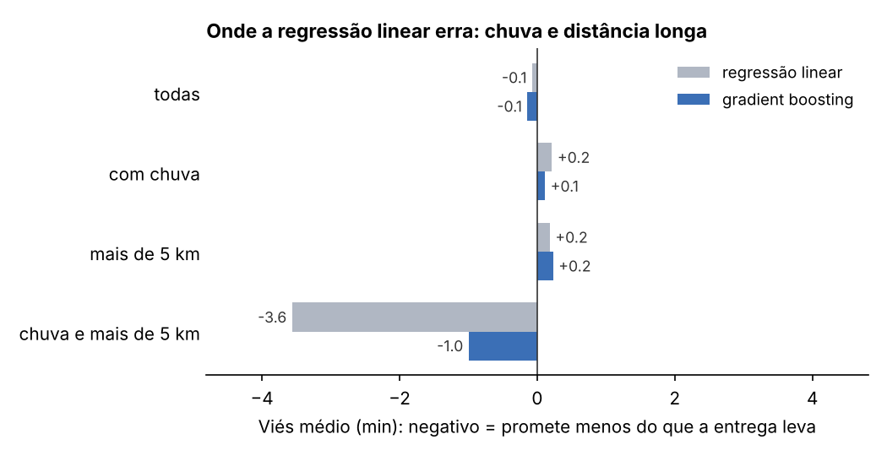
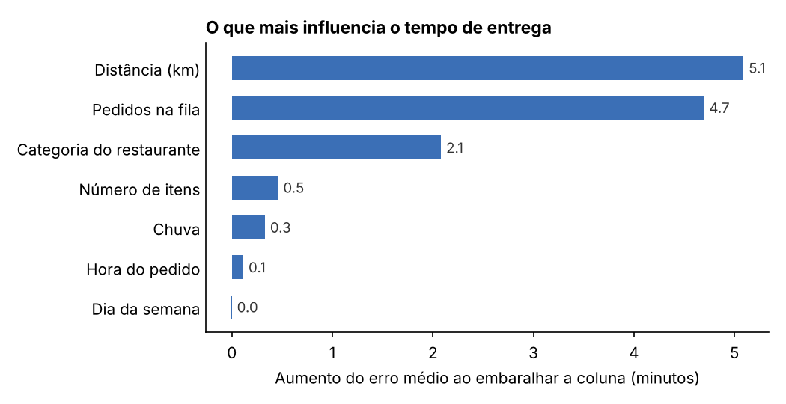

# Previsão de tempo de entrega com machine learning

Prevê quanto tempo uma entrega de comida vai levar e mostra uma **faixa de horário** ("chega entre 59 e 70 min"), como os apps de delivery fazem. O projeto compara três modelos, analisa onde cada um erra e calibra a faixa para que ela cumpra o que promete.

```
$ previsao-entrega prever --categoria pizzaria --dia sexta --hora 20:30 --distancia 6 --itens 3 --fila 6 --chuva
Previsão: 64 min (faixa provável: 59 a 70 min)
```

> **Sobre os dados:** são **sintéticos**, gerados por [`dados.py`](previsao_entrega/dados.py) com regras realistas e documentadas. Como as regras são conhecidas, dá para conferir se o modelo aprendeu o que de fato importa.

## Resultados

São 20.000 entregas simuladas: 16.000 para treino, com validação cruzada de 5 partes, e 4.000 para teste.

| Modelo | Erro médio (MAE), validação cruzada | Erro médio (MAE), teste | R² | Erro de até 10 min |
| --- | ---: | ---: | ---: | ---: |
| Baseline (sempre a mediana) | 9,26 ± 0,11 min | 9,32 min | −0,02 | 63% |
| Regressão linear | 3,55 ± 0,06 min | 3,54 min | 0,81 | 96% |
| **Gradient boosting (monotônico)** | **3,54 ± 0,07 min** | **3,51 min** | **0,81** | **96%** |

### A média esconde o problema

No geral, a regressão linear e o gradient boosting praticamente empatam. Separando por tipo de entrega, a diferença aparece:



Nas entregas **com chuva e mais de 5 km**, a regressão linear promete em média **3,6 min a menos** do que a entrega leva. O gradient boosting erra 1,0 min.

**Esse segmento é pequeno: 76 entregas no teste.** Com tão pouco, um único sorteio pode enganar. A primeira versão deste README dizia que o boosting errava "só 0,1 min", e isso foi sorte. Repeti a comparação com 5 conjuntos de dados diferentes (52 a 82 entregas no segmento em cada):

| Modelo | Erro médio (MAE) | Viés em chuva e mais de 5 km |
| --- | ---: | ---: |
| Regressão linear | 3,50 min | −3,7 min (de −4,4 a −3,4) |
| Gradient boosting sem restrição | 3,43 min | −0,4 min (de −0,8 a +0,1) |
| **Gradient boosting monotônico** | **3,46 min** | **−0,6 min (de −0,9 a −0,4)** |

A regressão linear erra em todos os sorteios. A conclusão se sustenta.

O motivo é que a chuva deixa cada quilômetro mais lento: o efeito da chuva **multiplica** o da distância. Um modelo linear só consegue **somar** efeitos, então erra justamente nas entregas mais demoradas. Para o cliente, esse é o pior erro possível: o pedido chega depois do prometido. Por isso o modelo escolhido foi o gradient boosting.

### Por que monotônico

Sem restrições, o gradient boosting às vezes prometia uma entrega **mais rápida com chuva** (1,2% dos pedidos) ou **mais rápida com mais distância** (0,4%). A diferença era de 1 minuto, mas um cliente que vê "chega antes se chover" deixa de confiar na previsão.

Por isso, o modelo tem restrições de monotonicidade: mais distância, mais itens, mais fila ou chuva **nunca** diminuem o tempo previsto. A hora e o dia ficam livres, porque têm picos e não uma direção. O custo, na tabela acima, é de 0,03 min de erro médio e 0,25 min a mais de viés no segmento raro. Para um app de entrega, a coerência vale mais. Um teste confere a regra em 100 pedidos aleatórios.

### O que o modelo aprendeu



O gráfico mostra a importância por permutação: quanto o erro aumenta quando os valores de uma coluna são embaralhados.

- **Distância e fila do restaurante** dominam, como nas regras da simulação.
- **Dia da semana tem importância zero.** Isso está certo: na simulação, o dia só afeta o tamanho da fila, e a fila já é uma coluna. O modelo não usou a correlação indireta.
- **Hora e chuva aparecem baixas** pelo mesmo motivo. Parte do efeito delas já chega pela fila, que cresce no pico e na chuva. A importância por permutação mede o que cada coluna acrescenta, não o impacto total da variável.

### Faixa de previsão calibrada

Para a faixa, treinei dois modelos de quantil: um para o percentil 10 e outro para o 90. A faixa deveria conter 80% das entregas reais, mas no teste continha só 77%.

Para corrigir, usei **conformal prediction**:
1. Separei uma parte do treino que os modelos não viram.
2. Medi quanto as entregas reais "escapavam" da faixa.
3. Alarguei a faixa na medida necessária.

| Faixa | Entregas dentro da faixa (meta: 80%) | Largura média |
| --- | ---: | ---: |
| Quantis puros | 77% | 9,9 min |
| **Calibrada** | **81%** | **10,6 min** |

Estes números são medidos na faixa **exatamente como o cliente a vê**, em minutos inteiros. A primeira versão arredondava as bordas para fora (para baixo e para cima). A faixa mostrada ficava 1 min mais larga e continha 85% das entregas, não os 80% medidos, e isso desfazia parte da calibração. Agora as bordas vão para o minuto mais próximo, e o treino mede a cobertura com a mesma função que monta a faixa mostrada. Um teste confere que os dois números são exatamente iguais.

**A promessa vale por tipo de entrega?** A calibração garante 80% na média de todas as entregas, não em cada grupo. Medi com 5 conjuntos de dados diferentes:

| Segmento | Dentro da faixa | Chega depois do fim da faixa | Entregas no teste |
| --- | ---: | ---: | ---: |
| Todas | 80% | 10% | 4.000 |
| Com chuva | 81% | 12% | 587 |
| Mais de 5 km | 78% | 10% | 526 |
| Chuva e mais de 5 km | 82% | 14% | 71 |
| Horário de pico | 81% | 11% | 2.770 |

A faixa se sustenta em todos os grupos, com o pior caso em "mais de 5 km" (78%). Para o cliente, o número que importa é a coluna do meio: a entrega chega **depois** do fim da faixa em 10% dos casos, e em 14% com chuva e distância longa. Para atrasar menos vezes, o caminho é calibrar a faixa para 90%, não arredondar para fora.

### Só prevê o que conhece

Árvores de decisão não extrapolam: fora do que viram no treino, repetem o valor da borda. A primeira versão respondia "66 min" para uma entrega de 50 km, ou de 1 bilhão de km, e "40 min" para um pedido às 3h da manhã, sempre com a mesma confiança.

Agora o modelo guarda os limites do treino e recusa o que está fora deles:

```
$ previsao-entrega prever --categoria pizzaria --dia sexta --hora 20h --distancia 50
Erro: distância 50 km está fora do que o modelo conhece (0,3 km a 10 km); a previsão não seria confiável
```

## Como usar (passo a passo)

Dá para testar sem saber programar: é copiar e colar os comandos. Os comandos abaixo são do **Windows (PowerShell, também o terminal do VS Code)**; quando o Linux ou o macOS são diferentes, eles aparecem em seguida.

### 1. Instale o Python

Precisa do Python 3.10 ou mais novo: baixe em [python.org/downloads](https://www.python.org/downloads/). No Windows, na primeira tela da instalação, marque **"Add python.exe to PATH"**. Para conferir, abra um terminal e rode `python --version`.

### 2. Baixe o projeto

No GitHub, clique no botão verde **Code → Download ZIP** e extraia o arquivo. Ou, se usa Git:

```powershell
git clone https://github.com/kayo598/previsao-tempo-entrega.git
```

Abra a pasta no VS Code (**File → Open Folder**) e abra o terminal com **Ctrl + '**.

### 3. Instale o projeto

```powershell
python -m venv .venv
.venv\Scripts\Activate.ps1
pip install -e ".[dev]"
```

```bash
# Linux e macOS
python3 -m venv .venv
source .venv/bin/activate
pip install -e ".[dev]"
```

O `.venv` é um ambiente separado: tudo o que é instalado fica dentro da pasta do projeto, e apagar a pasta desfaz tudo. Ao abrir um terminal novo, ative de novo com a segunda linha (a linha do terminal passa a começar com `(.venv)`).

### 4. Confira se está tudo certo

```powershell
python -m pytest
```

A última linha precisa dizer **passed** (e nenhum *failed*). Aqui os testes treinam modelos de verdade e levam cerca de 1 minuto.

### 5. Use

Este projeto não usa API de IA: tudo roda no seu computador, de graça, sem chave. Primeiro treine o modelo (uns 10 segundos), depois faça previsões:

```powershell
previsao-entrega treinar
previsao-entrega prever --categoria pizzaria --dia sexta --hora 20:30 --distancia 6 --itens 3 --fila 6 --chuva
previsao-entrega prever --categoria lanches --dia terça --hora 13h --distancia 1,2 --itens 1 --fila 1
```

O modelo, os gráficos e a amostra de dados são gravados na pasta atual (`modelos/`, `relatorios/` e `dados/`). Sem instalar, use `python -m previsao_entrega` na pasta do projeto.

- **Categorias:** `pizzaria`, `japones`, `lanches` e `brasileira`, com ou sem acento e maiúsculas.
- **Dia:** o nome (`sexta`, `sábado`, `seg`) ou o número, de `0` (segunda) a `6` (domingo).
- **Hora:** `20:30`, `20h30`, `20h` ou `20.5`.
- **Distância:** em km, com vírgula ou ponto (`2,5` ou `2.5`).
- **Outro arquivo de modelo:** `--modelo outro.joblib`, tanto no `treinar` quanto no `prever`.

Para várias previsões seguidas, como num serviço, carregue o modelo uma vez só: ler o arquivo leva cerca de 0,1 s.

```python
from previsao_entrega.prever import carregar, prever

modelo = carregar("modelos/modelo.joblib")
prever(
    {
        "categoria": "pizzaria",
        "dia_semana": 4,
        "hora": 20.5,
        "chuva": 1,
        "distancia_km": 6,
        "itens": 3,
        "pedidos_na_fila": 6,
    },
    modelo,
)
```

**Atenção:** um arquivo `.joblib` executa código ao ser lido. Use só modelos que você mesmo treinou.

### Problemas comuns

| O que aparece | O que fazer |
| --- | --- |
| `O termo 'previsao-entrega' não é reconhecido` | a `.venv` deste projeto não está ativa, ou o terminal está em outra pasta. A linha precisa começar com `(.venv)` e mostrar a pasta deste projeto; ative com `.venv\Scripts\Activate.ps1`. Se o arquivo não existir, falta o passo 3 |
| `Activate.ps1 não pode ser carregado porque a execução de scripts foi desabilitada` | rode uma vez `Set-ExecutionPolicy -Scope CurrentUser RemoteSigned` e confirme |
| `KeyboardInterrupt` no primeiro `pytest` dentro do VS Code | o VS Code interrompeu o terminal enquanto se configurava; rode `python -m pytest` de novo |
| Uma linha vermelha com `.venv-1` logo depois da instalação | é o VS Code tentando usar um ambiente que não existe. Aperte **Ctrl + Shift + P → Python: Select Interpreter** e escolha o que tem `.venv` |
| `Erro: modelo não encontrado em modelos/modelo.joblib` | o modelo ainda não foi treinado nesta pasta; rode `previsao-entrega treinar` antes |

## O que a revisão corrigiu

Além da faixa de distância e da monotonicidade, descritas acima:
- **`treinar --modelo meu.joblib` mentia.** Dizia "Modelo salvo em meu.joblib", mas salvava em `modelo.joblib`. Depois, `prever --modelo meu.joblib` não achava o arquivo.
- **`--linhas 10` treinava um modelo sem sentido** (R² de −13), gravava por cima do bom e escrevia `NaN` no `metricas.json`, o que deixa o JSON inválido para leitores estritos. Agora o mínimo é de 2.000 entregas, e o JSON é sempre válido.
- **Modelo corrompido, de versão antiga ou inexistente** davam traceback (`IndexError`, `KeyError`). Agora viram uma linha clara. Se o scikit-learn mudou desde o treino, aparece um aviso para treinar de novo.
- **Tipos errados passavam:** `chuva=7`, `hora=True`, `itens=2.5` e distância infinita eram aceitos, e `dia_semana="5"` dava traceback. Cada caso tem agora uma mensagem própria.
- **O terminal do Windows quebrava** no "≤" da tabela de resultados, depois de o modelo já ter sido salvo.
- **Uma falha ao gravar destruía o modelo anterior.** Com o disco cheio no meio da gravação, o modelo bom virava um arquivo corrompido. Agora o modelo é gravado num arquivo temporário e só troca de lugar no fim, de uma vez.
- **Valores do numpy eram recusados.** Um valor tirado de uma coluna do pandas (`df["dia_semana"].iloc[0]`) é `numpy.int64`, e era recusado com "dia_semana vai de 0 a 6", mesmo valendo 4.
- **Não dava para rodar de outra pasta nem instalar:** faltava o `pyproject.toml`, e os arquivos iam para a pasta do código. Agora vão para a pasta atual.

## Testes

```bash
python -m pytest            # cerca de 1 minuto: os testes treinam modelos de verdade
ruff check . && ruff format --check .
mypy previsao_entrega
```

São 118 testes:

| Arquivo | O que cobre |
| --- | --- |
| [`test_previsao.py`](tests/test_previsao.py) | dados reprodutíveis; modelo ganha do baseline e não subestima chuva com distância longa; faixa calibrada; previsão nunca menor com mais distância, itens, fila ou chuva (100 pedidos aleatórios); limites do treino; tipos inválidos e tipos do numpy; falha no meio da gravação; modelo corrompido, antigo ou de outra versão do scikit-learn; quantis cruzados; a cobertura relatada é exatamente a da faixa mostrada, conferida pedido a pedido; JSON estrito |
| [`test_cli.py`](tests/test_cli.py) | treinar e prever de ponta a ponta numa pasta vazia; `--modelo` com outro nome; `--linhas` pequeno; erros em uma linha; formatos de hora, de dia e de distância (com vírgula); terminal do Windows (cp1252); Ctrl+C de verdade |

**Os testes foram testados:**
- **Cobertura de linhas:** 98,8%. O que falta é o tratamento do Ctrl+C, que roda num processo separado no teste.
- **Testes de mutação.** Em três rodadas, foram plantados 39 bugs, um por vez, e os testes pegam 37. Um é equivalente: a ordem das colunas já era a mesma. O outro revelou uma checagem redundante, que foi retirada. Na primeira rodada, 4 bugs passaram despercebidos e viraram testes: um modelo com todos os campos mas de formato antigo, quantis cruzados, faixa abaixo de zero e abreviação de dia curta demais.

Os testes rodam em Python 3.13. O scikit-learn não está instalado para outras versões no ambiente em que o projeto foi revisado; para 3.10, foram verificados a sintaxe (com o ruff) e o uso da biblioteca padrão, procurando funções que só existem a partir do 3.11; não havia um Python 3.10 disponível para rodar os testes.

## Estrutura

```
previsao_entrega/
  dados.py      gerador de dados sintéticos (regras documentadas)
  modelos.py    baseline, regressão linear, gradient boosting, quantis
  treino.py     validação cruzada, análise por segmento, faixa calibrada, gráficos
  prever.py     previsão com o modelo salvo
dados/          amostra de 200 linhas (gerada pelo treino)
relatorios/     métricas e gráficos gerados no treino
tests/
```

## Próximos passos

- Testar com dados reais de entrega, como bases públicas do Kaggle.
- Servir o modelo como API e monitorar o erro ao longo do tempo (drift).
- Calibrar a faixa por segmento, porque entregas com chuva são mais incertas.
- Repetir a avaliação por segmento com vários sorteios dentro do próprio `treinar`, em vez de só no README.
